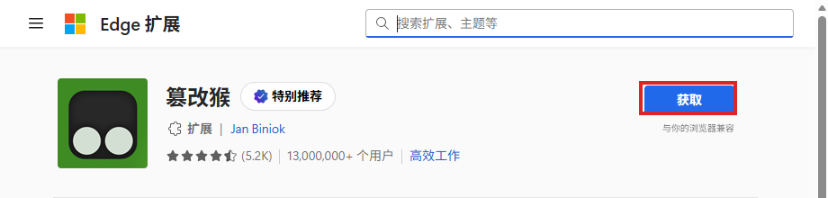
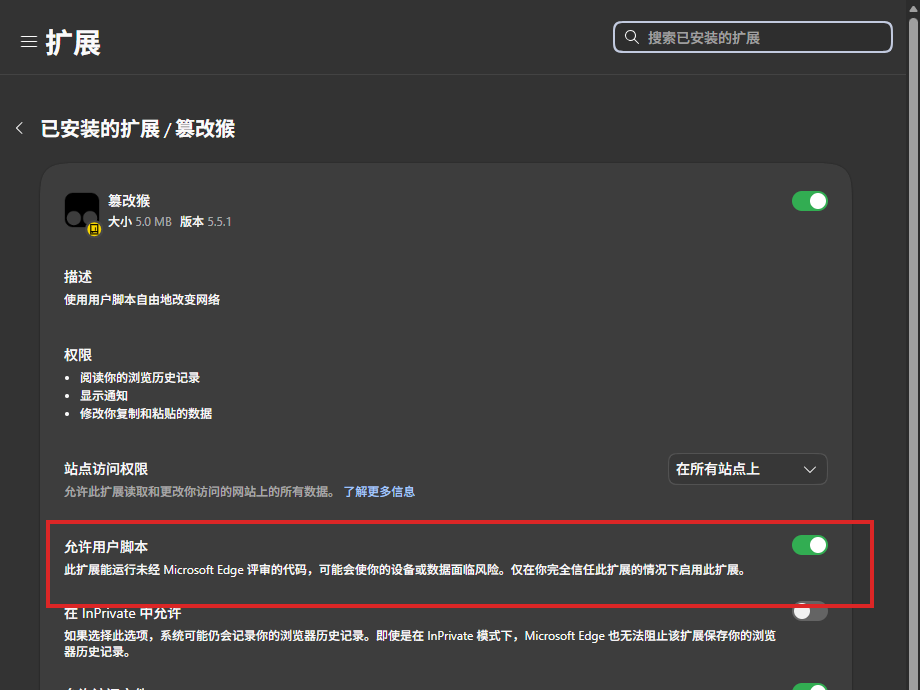
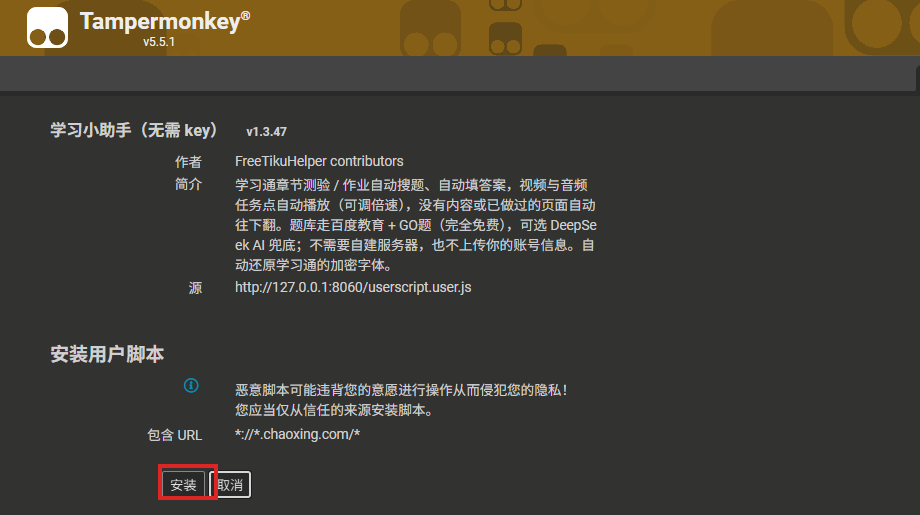
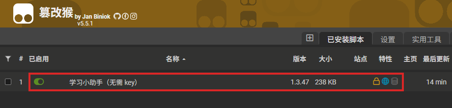

# 学习小助手 1.3.47 · 详细安装教程（Windows）

> **适用系统**：Windows 10 / 11（64 位）  
> **浏览器**：Microsoft Edge 或 Google Chrome（推荐 Edge）  
> **程序版本**：v1.3.47  
> **教程更新**：2026-10-27  
> **官方仓库**：<https://github.com/26084396lmd-lab/study-tools>  
> **发布页**：<https://github.com/26084396lmd-lab/study-tools/releases/tag/v1.3.47>  
> **直接下载**：<https://github.com/26084396lmd-lab/study-tools/releases/download/v1.3.47/study-helper-1.3.47.zip>  
> **校验文件**：<https://github.com/26084396lmd-lab/study-tools/releases/download/v1.3.47/SHA256SUMS.txt>

---

## 目录

1. [先选一条安装路线](#1-先选一条安装路线)
2. [安装前准备](#2-安装前准备)
3. [下载与校验](#3-下载与校验)
4. [解压](#4-解压)
5. [安装 Tampermonkey（篡改猴）](#5-安装-tampermonkey篡改猴)
6. [必须开启“允许用户脚本”](#6-必须开启允许用户脚本)
7. [安装学习小助手脚本](#7-安装学习小助手脚本)
8. [启动与使用](#8-启动与使用)
9. [让 AI 助手全自动安装](#9-让-ai-助手全自动安装)
10. [常见问题与解决办法](#10-常见问题与解决办法)
11. [更新、卸载与隐私](#11-更新卸载与隐私)
12. [文件清单与官方链接](#12-文件清单与官方链接)

---

## 1. 先选一条安装路线

| 你是谁 | 推荐路线 | 大约耗时 | 你需要做什么 |
|---|---|---|---|
| 普通用户，想自己点几下 | **路线 A：手动安装** | 5–10 分钟 | 装 Tampermonkey、开一个开关、装脚本、双击启动 |
| 有 AI 助手（OpenCode / Claude Code / 豆包等） | **路线 B：AI 全自动安装** | 2–5 分钟 | 把提示词发给 AI，最后自己登录学习通 |

> **两条路线装的是同一个东西**，只是路线 B 让 AI 帮你完成下载、解压、启动、装扩展、装脚本和验证。  
> 无论哪条路线，**学习通账号密码都只能由你自己输入**，AI 不需要、也不应该知道你的密码。

### 路线 A 的 6 个动作（先有个印象）

1. 下载 `study-helper-1.3.47.zip`；
2. 解压到一个普通文件夹（不要直接在压缩包里运行）；
3. 在 Edge / Chrome 安装 **Tampermonkey（篡改猴）**；
4. 在扩展详情里打开 **“允许用户脚本”**；
5. 双击 `一键启动.bat`，在打开的安装页点 **“安装脚本”**，再点 **“安装”**；
6. 登录学习通，打开课程章节，右侧出现“学习小助手”面板。

### 路线 B 的 3 个动作

1. 把第 9 节的提示词整段发给 AI 助手；
2. AI 自动完成安装，并在最后打开一个名为 **“学习小助手浏览器”** 的 Edge 窗口；
3. 你在那个窗口里登录学习通，进入课程章节即可。

---

## 2. 安装前准备

### 2.1 必须满足

- Windows 10 或 Windows 11，64 位；
- 能正常上网（需要访问 GitHub 和浏览器扩展商店）；
- 至少 300 MB 空闲磁盘空间；
- 一个能正常登录的超星学习通账号；
- Microsoft Edge 或 Google Chrome（Windows 10/11 一般自带 Edge）。

### 2.2 不需要的东西

- **不需要管理员权限**（手动安装和 AI 自动安装都不需要）；
- **不需要安装 Python**（发布包里是打包好的 exe）；
- **不需要安装 Node.js**（只有“日志区壁纸轮换”这个可选功能需要，没有不影响搜题和刷课）；
- **不需要 DeepSeek / OpenAI 的 Key**（免费题库照样能用，Key 只是冷门题的 AI 兜底）。

### 2.3 重要提醒

- 程序没有数字签名，Windows 第一次运行 exe 时可能弹出 **“Windows 已保护你的电脑”**。  
  确认文件来自本仓库、并且 SHA256 校验一致后，点 **“更多信息 → 仍要运行”**。
- 杀毒软件可能对“自动答题脚本 + 本地服务”误报。  
  **不要直接关闭杀毒软件**；先核对文件来源和 SHA256，再决定是否添加信任。介意安全风险就不要用。
- 本工具会自动化学习通页面操作，**可能违反学习通用户协议**；请勿用于考试。风险自负，详见文末免责声明。

---

## 3. 下载与校验

### 3.1 官方下载地址

| 内容 | 地址 |
|---|---|
| 发布页（推荐先打开） | <https://github.com/26084396lmd-lab/study-tools/releases/tag/v1.3.47> |
| 直接下载 zip | <https://github.com/26084396lmd-lab/study-tools/releases/download/v1.3.47/study-helper-1.3.47.zip> |
| SHA256 校验文件 | <https://github.com/26084396lmd-lab/study-tools/releases/download/v1.3.47/SHA256SUMS.txt> |
| 项目主页 | <https://github.com/26084396lmd-lab/study-tools> |

> 发布页上的附件显示名可能是 **“学习小助手-1.3.47-清洁版.zip”**，实际下载文件名是 `study-helper-1.3.47.zip`，这是 GitHub 对中文文件名的处理，**两个是同一个文件**。

**不要**点仓库首页的 **“Code → Download ZIP”**：那是源码包，里面没有 exe 和启动脚本，不能直接运行。

### 3.2 校验 SHA256（强烈建议）

下载完成后，在 zip 所在文件夹按住 `Shift` 点右键 → **“在此处打开 PowerShell 窗口”**，执行：

```powershell
Get-FileHash .\study-helper-1.3.47.zip -Algorithm SHA256
```

把输出的 `Hash` 和下面任意一个地方的值对比（大小写不敏感）：

- 发布页正文里的 `SHA256`；
- 发布页附件 `SHA256SUMS.txt` 里的第一列；
- 也可以用命令自动对比：

```powershell
$zip = ".\study-helper-1.3.47.zip"
$expected = (Get-Content .\SHA256SUMS.txt | Select-String "study-helper-1.3.47.zip").Line.Split()[0]
$actual = (Get-FileHash $zip -Algorithm SHA256).Hash
if ($actual -eq $expected) { "校验通过：$actual" } else { "校验失败！请重新下载，不要运行" }
```

**如果校验失败**：不要解压、不要运行，删除文件后重新从上面的官方地址下载。  
**如果 GitHub 打不开**：换网络（手机热点等）再试；或者让仓库作者把发布包直接发给你。不要从陌生网盘/第三方站点下载，除非你能确认来源和 SHA256。

---

## 4. 解压

1. 找到下载好的 `study-helper-1.3.47.zip`；
2. 右键 → **“全部解压缩”**（Windows 11 也可能显示“提取全部”）；
3. 解压到 **一个普通文件夹**，例如：
   - `C:\学习小助手`
   - `D:\学习小助手`
   - `C:\Users\你的用户名\Desktop\学习小助手`
4. **不要**解压到 `C:\Program Files`（需要管理员权限，容易出问题）；
5. **不要**直接在压缩包里双击 exe（会缺少同目录文件）。

解压后应该能看到这些文件（至少）：

```text
学习小助手-1.3.47-清洁版\
├─ 启动免费题库.exe
├─ 一键启动.bat
├─ hide.vbs
├─ 安装.html
├─ 安装教程.html          ← 本教程的网页版
├─ 安装教程.md
├─ AGENT_INSTALL.md       ← 给 AI 助手看的安装说明
├─ AI自动安装.ps1         ← AI/高级用户自动安装脚本
├─ AI自动安装.bat         ← 双击运行上面的脚本
├─ 学习小助手.user.js
├─ 使用说明-先看这个.txt
├─ 设置我的AI-Key.bat
├─ 停止学习小助手.bat
└─ 教程图片\...
```

如果缺少 `启动免费题库.exe` 或 `一键启动.bat`，说明你下载的是源码包或解压不完整，请回到第 3 节重新下载发布包。

---

## 5. 安装 Tampermonkey（篡改猴）

Tampermonkey 是一个浏览器扩展，负责运行 `学习小助手.user.js`。  
它**不在压缩包里**，需要从官方扩展商店安装（免费）。

### 5.1 官方安装地址

| 浏览器 | 官方商店地址 |
|---|---|
| **Microsoft Edge（推荐）** | <https://microsoftedge.microsoft.com/addons/detail/tampermonkey/iikmkjmpaadaobahmlepeloendndfphd> |
| Google Chrome | <https://chromewebstore.google.com/detail/tampermonkey/dhdgffkkebhmkfjojejmpbldmpobfkfo> |
| Firefox（可选） | <https://addons.mozilla.org/firefox/addon/tampermonkey/> |
| Tampermonkey 官网 | <https://www.tampermonkey.net/> |

> 建议用 **Edge**：Windows 自带、商店访问通常更稳定，AI 自动安装也默认用 Edge。

### 5.2 Edge 安装步骤（看图操作）

1. 用 Edge 打开上面的 **Edge 加载项**地址；
2. 页面右上角有一个蓝色的 **“获取”** 按钮，点它（见下图红框）；
3. 弹出确认框后点 **“添加扩展”**；
4. 地址栏右边出现 Tampermonkey 的图标（两个黑白小圆点）就说明装好了；如果没看到，点浏览器右上角的“扩展”拼图图标，把 Tampermonkey 旁边的“眼睛/图钉”打开。



### 5.3 Chrome 安装步骤

1. 用 Chrome 打开上面的 **Chrome 网上应用店**地址；
2. 点右上角 **“添加至 Chrome”**；
3. 弹出确认框点 **“添加扩展程序”**；
4. 在地址栏右边的扩展图标里找到 Tampermonkey，必要时点图钉固定。

### 5.4 装不上怎么办

- 页面打不开 / 一直转圈：换网络（手机热点）再试；Edge 和 Chrome 的商店可以互换尝试。
- 提示“此扩展程序在您的地区不可用”：换 Edge 商店，或让能访问商店的朋友帮你确认版本；不要从陌生站点下载 crx。
- 公司/学校电脑提示“受组织管理，无法安装”：这是企业策略限制，需要管理员解除；普通方法装不了。
- 装完图标是灰色的：点一下图标，看是否提示“已停用”；在扩展管理页把它启用。

---

## 6. 必须开启“允许用户脚本”

> **这是最容易漏掉、也是最重要的一步。**  
> Edge / Chrome 新版本给扩展加了一个安全开关。Tampermonkey 5.5+ 如果不开这个开关，脚本能“装进去”，但**不会运行**，页面上也不会出现面板。

### 6.1 Edge 操作

1. 在 Edge 地址栏输入并回车：

   ```text
   edge://extensions
   ```

2. 找到 **“篡改猴 / Tampermonkey”**，点 **“详细信息”**；
3. 往下找到 **“允许用户脚本”**；
4. 把右边的开关打开（变成绿色/蓝色）；
5. 如果看到“此扩展能运行未经 Microsoft Edge 评审的代码……”的提示，这是正常的安全提示，确认你信任 Tampermonkey 后打开即可。



### 6.2 Chrome 操作

1. 地址栏输入：

   ```text
   chrome://extensions
   ```

2. 找到 **Tampermonkey**，点 **“详细信息”**；
3. 找到 **“允许用户脚本 / Allow user scripts”**，打开开关。

### 6.3 找不到这个开关？

- 先把 Edge / Chrome 更新到最新版（右上角 `...` → 帮助 → 关于）；
- 确认 Tampermonkey 是 **5.5 或更高版本**；
- 某些旧版浏览器没有这个开关，也不会拦截脚本，可以继续下一步；
- 如果 Tampermonkey 管理面板仍提示“请启用‘允许用户脚本’”，回到本节重新打开，然后刷新管理面板。

---

## 7. 安装学习小助手脚本

### 7.1 先启动本地服务

1. 回到解压后的文件夹；
2. 双击 **`一键启动.bat`**；
3. 第一次运行可能出现：
   - **“Windows 已保护你的电脑”** → 点“更多信息 → 仍要运行”；
   - 杀毒软件提示 → 确认来源和 SHA256 后允许；
4. 程序会在后台启动本地服务（默认 `127.0.0.1:8060`），并自动打开 **`安装.html`**；
5. 如果浏览器没有自动打开，手动双击 `安装.html`，或直接访问：

   ```text
   http://127.0.0.1:8060/install
   ```

> 本地服务是隐藏运行的，任务栏不一定有窗口。**不要**在任务管理器里随手结束它；结束后面板会显示“题库桥没在跑”。

### 7.2 点“安装脚本”

在 `安装.html` 页面点绿色的 **“＋ 安装脚本”** 按钮，浏览器会打开：

```text
http://127.0.0.1:8060/userscript.user.js
```

正常情况下，Tampermonkey 会拦截这个地址，弹出一个 **“安装用户脚本”** 页面，显示脚本名称、版本、作者和“安装 / 取消”按钮。



点 **“安装”**。如果又弹出一个确认框，再点一次 **“安装”**。

### 7.3 如果打开是一堆代码（重要）

如果点“安装脚本”后，页面显示的是一整页 JavaScript 代码（以 `// ==UserScript==` 开头），说明 Tampermonkey 还没有拦截到这次请求。**按 `F5` 或 `Ctrl + R` 刷新一次**，通常就会变成正常的安装页。

如果刷新多次还是代码页：

1. 确认 Tampermonkey 已经安装并且启用；
2. 确认第 6 节的 **“允许用户脚本”** 已经打开；
3. 关掉这个标签页，回到 `安装.html` 重新点“安装脚本”；
4. 还不行就把 `学习小助手.user.js` 文件直接拖进浏览器窗口，Tampermonkey 也会弹出安装页；
5. 再不行：点 Tampermonkey 图标 → **“管理面板”** → **“实用工具”** → 找“从 URL 安装”，粘贴：

   ```text
   http://127.0.0.1:8060/userscript.user.js
   ```

### 7.4 确认安装成功

点 Tampermonkey 图标 → **“管理面板”**（或“已安装脚本”），应该能看到一行：

```text
学习小助手（无需 key）    1.3.47    已启用
```



同时确认：

- 脚本前面的开关是 **绿色/已启用**；
- 面板里**没有**“请启用‘允许用户脚本’扩展设置”的警告；
- 版本是 **1.3.47**（不是旧版）。

> 如果之前装过旧版本，建议先在管理面板里删除旧版，再按本节重新安装，避免两个脚本同时抢页面。

---

## 8. 启动与使用

### 8.1 打开学习通

1. 用装好 Tampermonkey 的浏览器打开学习通并登录：

   ```text
   https://passport2.chaoxing.com/login
   ```

2. 进入你的课程 → 章节 / 任务点 / 作业页面；
3. 页面右侧（或右下角）会出现 **“学习小助手”** 面板；
4. 在面板里选择模式：
   - **流水线（全自动）**：做题 + 视频全包；
   - **只看视频/音频**：题目跳过，视频看完自动下一节；
   - **只做题**：视频跳过，只答题；
5. 点 **“▶ 一键启动”** 开始；点 **“■ 全部停止”** 随时停止。

### 8.2 使用注意事项

- 面板默认什么都不做，必须点“一键启动”；
- **考试 / 监考页面不要用**；
- 学习通页面上只保留一个同类脚本，避免互相抢页面；
- 本地服务（`127.0.0.1:8060`）必须保持运行；浏览器面板提示“题库桥没在跑”时，回到文件夹重新双击 `一键启动.bat`；
- 如果页面没有面板：先按 `F5` 刷新；确认当前网址是 `*.chaoxing.com` 的课程/章节页，而不是登录页或空白页；确认脚本已启用、第 6 节开关已打开。

### 8.3 可选：配置 AI 兜底

不填 Key 也能用免费题库搜题；只有冷门题搜不到时，才需要 AI。

1. 双击 **`设置我的AI-Key.bat`**；
2. 按提示选择服务商（DeepSeek / Kimi / 通义 / 智谱 / OpenAI / 自定义）；
3. 粘贴你自己的 API Key（只保存在本机 `ai_config.json`）；
4. 重新打开 `安装.html`，点 **“打开 AI 设置页”** 确认状态。

> Key 只存在你的电脑上，不会上传到本项目仓库；但启用 AI 后，题目文本会发送给你选择的 AI 服务商，请自行阅读对方的隐私政策。

---

## 9. 让 AI 助手全自动安装

> 这一节是给 **有终端 / 浏览器工具的 AI 助手**（OpenCode、Claude Code、Cursor、豆包等）看的。  
> AI 会完成下载、校验、解压、启动、装 Tampermonkey、装脚本、开启“允许用户脚本”、验证，并在最后打开学习通登录页。  
> **它不会、也不应该询问或输入你的学习通密码。**

### 9.1 直接复制这段提示词给 AI

```text
你是我的安装助手。请完整阅读并严格执行：
https://raw.githubusercontent.com/26084396lmd-lab/study-tools/main/AGENT_INSTALL.md

目标：自动安装“学习小助手”（桌面程序 + 专用 Edge 浏览器 + Tampermonkey + 用户脚本），并完成验证。

要求：
1. 只从官方 GitHub 和 Tampermonkey 官方商店/官方 CRX 接口下载；
2. 不要询问、输入或保存我的学习通账号密码；需要登录时停下来让我操作；
3. 安装完成后，把安装目录、验证结果和下一步告诉我。
```

### 9.2 AI 会做什么

1. 检查 Windows / PowerShell / Edge / 磁盘空间；
2. 从官方 Release 下载 `study-helper-1.3.47.zip`；
3. 下载 `SHA256SUMS.txt` 并校验 SHA256；不一致就停止；
4. 解压到 `%LOCALAPPDATA%\学习小助手`（不会覆盖你的 `ai_config.json`）；
5. 启动本地服务，检查 `http://127.0.0.1:8060/ping`；
6. 创建一个**专用 Edge 配置**（不影响你原来的浏览器）；
7. 从官方商店接口下载 Tampermonkey，加载到专用配置；
8. 打开用户脚本安装页，自动点“安装”；
9. 在 `edge://extensions` 里自动打开“允许用户脚本”；
10. 验证管理面板里能看到 `学习小助手 1.3.47`；
11. 在桌面创建 **“学习小助手浏览器”** 快捷方式；
12. 打开学习通登录页，把最后一步留给你。

### 9.3 你也可以自己运行安装脚本

如果 AI 不能直接执行终端命令，你可以在 PowerShell 里运行：

```powershell
$u = "https://raw.githubusercontent.com/26084396lmd-lab/study-tools/main/tools/agent-install.ps1"
$p = "$env:TEMP\study-helper-agent-install.ps1"
Invoke-WebRequest -Uri $u -OutFile $p -UseBasicParsing
Unblock-File $p
powershell -NoProfile -ExecutionPolicy Bypass -File $p
```

或者：解压发布包后，双击 **`AI自动安装.bat`**（它会在同一个文件夹里运行 `AI自动安装.ps1`）。

脚本运行结束后会生成：

```text
%LOCALAPPDATA%\学习小助手\install-result.json
%LOCALAPPDATA%\学习小助手\install.log
```

`install-result.json` 里的 `ok` 为 `true` 就表示安装和验证通过。  
如果失败，把 `install.log` 的最后几十行发给 AI 或仓库作者。

### 9.4 AI 安装后的使用

1. 桌面上会出现 **“学习小助手浏览器”** 快捷方式；
2. 双击它，会打开一个专用的 Edge 窗口（第一次可能需要初始化几秒）；
3. 在这个窗口里登录学习通；登录一次后，专用配置会记住登录状态；
4. 进入课程章节，右侧出现面板即可使用；
5. 以后都用这个快捷方式，不要用原来的浏览器窗口（原来的浏览器没有装脚本也没关系）。

> **专用浏览器必须通过桌面快捷方式「学习小助手浏览器」或安装目录里的 `start-browser.cmd` 启动。**  
> 直接双击普通 Edge/Chrome 图标不会带专用配置和 `--load-extension`，脚本不会出现；这不是安装失败。

> **为什么用专用浏览器？**  
> 这样 AI 可以在不碰你日常浏览器、不修改系统策略的情况下，把 Tampermonkey 和脚本装好、验证好。  
> 代价是：你需要在这个新窗口里重新登录一次学习通。你的原浏览器书签、密码、插件都不受影响。

### 9.5 AI 安装的边界（请提前知道）

- **AI 不能替你登录学习通**：账号密码、短信验证码、扫码都必须你本人操作；这是安全边界，不是安装失败。
- **专用配置通常不会重置**：正常更新会复用 `browser\edge-profile`，学习通登录状态会保留。只有专用配置里的 Tampermonkey 无法使用（例如配置损坏、扩展被禁用）时才会自动重置一次并重试；届时需要重新登录（不影响你的日常浏览器）。
- **SmartScreen 可能仍会弹一次**：exe 没有数字签名，AI 不能在不关闭系统安全功能的前提下绕过它；确认 SHA256 后点“更多信息 → 仍要运行”即可。
- **网络可能挡住扩展下载**：如果 Chrome Web Store / Edge 商店都访问不了，AI 会停下来告诉你去手动安装 Tampermonkey；装好后重新运行脚本即可。
- **专用浏览器不是你的日常浏览器**：它的登录状态、书签、插件是独立的；如果你不想用专用窗口，可以按路线 A 在你自己的浏览器里手动安装。

---

## 10. 常见问题与解决办法

### 10.1 下载 / 校验

**Q：GitHub 打不开、下载很慢？**  
A：换网络（手机热点）、稍后重试，或让作者直接发你发布包。不要从陌生网盘下载；如果必须用第三方，务必核对发布页的 SHA256。

**Q：下载下来是 `study-tools-main.zip`，里面没有 exe？**  
A：你点的是“Code → Download ZIP”源码包。回到发布页下载 `study-helper-1.3.47.zip`。

**Q：SHA256 对不上？**  
A：不要运行。删除后重新下载；仍然不对就说明文件被篡改或下载不完整。

### 10.2 Windows / 杀毒

**Q：提示“Windows 已保护你的电脑”？**  
A：确认文件来自本仓库且 SHA256 一致，点“更多信息 → 仍要运行”。程序没有数字签名，这是正常提示。

**Q：杀毒软件报毒 / 直接删除 exe？**  
A：这类“自动答题 + 本地服务 + 浏览器脚本”工具容易被启发式误报。先核对来源和 SHA256；确认无误后，可在杀毒软件里把整个安装文件夹加入信任/排除。**不要**为了它长期关闭实时防护。介意风险就不要用。

**Q：双击 `一键启动.bat` 黑窗口一闪就没了？**  
A：在文件夹空白处按住 `Shift` 右键 → “在此处打开 PowerShell 窗口”，运行：

```powershell
.\一键启动.bat
```

看具体报错；常见原因是端口 8060 被占用、exe 被隔离、路径权限不足。

### 10.3 端口 / 本地服务

**Q：面板显示“题库桥没在跑” / “无法连接本地服务”？**  
A：本地服务没启动或已退出。回到文件夹双击 `一键启动.bat`；确认浏览器能打开：

```text
http://127.0.0.1:8060/ping
```

看到 `{"ok": true}` 就说明服务正常。

**Q：提示端口 8060 被占用？**  
A：可能已经有一个学习小助手在运行，或者别的程序占用了 8060。查看占用：

```powershell
netstat -ano | findstr :8060
```

如果是旧的学习小助手进程，结束它再启动；如果是其他程序，换一台机器/联系作者，不要随便结束不认识的进程。

**Q：关闭黑窗口后脚本还能用吗？**  
A：不能。本地服务必须运行；黑窗口/后台进程关掉后，脚本无法搜题。重新双击 `一键启动.bat` 即可。

### 10.4 Tampermonkey / 脚本

**Q：安装页打开是一堆代码？**  
A：按 `F5` 刷新一次；仍不行就按第 7.3 节的 5 个办法排查。

**Q：Tampermonkey 管理面板提示“请启用‘允许用户脚本’”？**  
A：按第 6 节打开 `edge://extensions` 或 `chrome://extensions` → Tampermonkey → 详细信息 → 允许用户脚本 → 打开，然后刷新面板。

**Q：Tampermonkey 图标找不到？**  
A：点浏览器右上角的“扩展”拼图图标，找到 Tampermonkey，点图钉/眼睛把它固定到工具栏。

**Q：脚本装了但学习通页面没有面板？**  
A：依次检查：
1. 当前网址是不是 `*.chaoxing.com` 的课程/章节页；
2. 脚本是否“已启用”；
3. “允许用户脚本”是否打开；
4. 本地服务是否在跑（`/ping`）；
5. 按 `F5` 刷新；
6. 是否同时装了其他学习通脚本（只保留一个）；
7. 打开浏览器 F12 控制台看有没有红色报错；把报错和 `install.log` 发给作者。

**Q：能装多个学习通脚本吗？**  
A：不建议。多个脚本会同时改页面、抢按钮，容易出现“怎么都不动”。只保留学习小助手。

### 10.5 使用 / 题库 / AI

**Q：搜不到答案？**  
A：免费题库有覆盖范围；冷门题可能没有。可以配置 DeepSeek 等 AI 兜底；也可以手动检查题目是否被学习通加密字体/图片公式影响。

**Q：AI 一直失败？**  
A：检查 `设置我的AI-Key.bat` 里的服务商、base_url、模型名和 Key；确认 Key 有余额；确认网络能访问该服务商。没有 Key 不影响免费题库。

**Q：视频不自动播放？**  
A：浏览器可能拦截自动播放；先在页面上点一下视频区域，确认没静音、没暂停；某些课程需要保持标签页在前台。

**Q：考试页会自动答题吗？**  
A：不会。脚本会回避考试/监考页面；也请你不要用于考试。

### 10.6 AI 自动安装 / 专用浏览器

**Q：AI 安装后为什么要用“学习小助手浏览器”？**  
A：因为脚本装在专用 Edge 配置里；用这个快捷方式才能带上 Tampermonkey 和脚本。原来的浏览器不受影响。

**Q：双击普通 Edge 图标，学习通没有面板？**  
A：AI 安装的脚本在专用配置里；请用桌面「学习小助手浏览器」快捷方式，或安装目录里的 `start-browser.cmd` 启动。不要直接双击普通 Edge 图标。

**Q：专用浏览器配置坏了、一直打不开？**  
A：先关闭专用浏览器，删除 `%LOCALAPPDATA%\学习小助手\browser\edge-profile`，再重新运行 `AI自动安装.bat`。这会丢失专用配置里的学习通登录状态（不影响你的日常浏览器），需要重新登录一次。

**Q：专用浏览器提示配置被占用 / 打不开？**  
A：可能已经有一个“学习小助手浏览器”窗口开着。先关掉它（不是关你日常的 Edge），再双击快捷方式。

**Q：AI 脚本失败，提示需要手动装 Tampermonkey？**  
A：按第 5 节在专用浏览器里装 Tampermonkey，再按第 6 节开“允许用户脚本”，然后重新运行 `AI自动安装.ps1`（它会复用已安装的扩展和配置）。

**Q：AI 会知道我的学习通密码吗？**  
A：不会。脚本和提示词都明确禁止询问/输入账号密码；登录页由你自己操作。

---

## 11. 更新、卸载与隐私

### 11.1 更新

1. 打开发布页，下载新版本 zip；
2. 解压后，把新的 `启动免费题库.exe`、`学习小助手.user.js` 等文件覆盖到原文件夹；
3. **保留**你的 `ai_config.json`（API Key）；
4. 在 Tampermonkey 管理面板里确认脚本版本已更新；必要时删除旧脚本再装一次；
5. 重启 `一键启动.bat`。

> 覆盖前先关闭正在运行的学习小助手本地服务（或重启电脑），否则 exe 可能被占用。

### 11.2 卸载

1. 关闭学习小助手本地服务（结束 `启动免费题库.exe` 进程，或重启电脑）；
2. 删除整个安装文件夹；
3. 在浏览器扩展管理页卸载 Tampermonkey（如果你不再需要它）；
4. 如果用了 AI 专用浏览器，删除：
   - `%LOCALAPPDATA%\学习小助手`（包含专用 Edge 配置和扩展）；
   - 桌面上的“学习小助手浏览器”快捷方式；
5. 你的日常浏览器、书签、密码不会被删除。

### 11.3 隐私

- 本地服务只监听 `127.0.0.1:8060`，不对局域网/公网开放；
- 题库请求从你的浏览器发往百度教育 / GO题等公开接口；
- 不填 AI Key 时，不会把题目发给 AI；
- 填了 AI Key 后，冷门题/图片公式题可能会发送给你选择的 AI 服务商；
- 脚本不上传你的学习通账号密码；
- 不要把 `ai_config.json` 发给别人，它可能包含你的 API Key。

### 11.4 免责声明

- 本项目与超星 / 学习通官方**无任何关联**，仅供个人学习交流；
- 请遵守你所在学校/机构的规定，**不要用于考试**；
- 自动答题、自动播放视频可能违反学习通用户协议，请自行评估风险；
- 使用本项目产生的任何后果由使用者自行承担；
- 本项目以 GPL-3.0-or-later 发布；第三方代码归属见 `THIRD_PARTY_NOTICES.md`。

---

## 12. 文件清单与官方链接

### 12.1 发布包里的关键文件

| 文件 | 作用 |
|---|---|
| `启动免费题库.exe` | 本地题库/AI 桥，监听 `127.0.0.1:8060` |
| `一键启动.bat` | 启动本地服务并打开安装页（普通用户用） |
| `安装.html` | 图形化安装页 |
| `安装教程.html` / `安装教程.md` | 本教程 |
| `AGENT_INSTALL.md` | 给 AI 助手的完整安装说明 |
| `AI自动安装.ps1` / `AI自动安装.bat` | AI/高级用户自动安装脚本 |
| `学习小助手.user.js` | 浏览器用户脚本（装进 Tampermonkey） |
| `使用说明-先看这个.txt` | 简短版说明 |
| `设置我的AI-Key.bat` | 可选：配置 AI Key |
| `停止学习小助手.bat` | 停止占用 `127.0.0.1:8060` 的本地服务 |
| `hide.vbs` | 隐藏启动本地服务的小工具 |
| `wallpaper-server.js` | 可选：面板壁纸服务（需要 Node.js） |
| `LICENSE` / `THIRD_PARTY_NOTICES.md` | 许可证与第三方归属 |

### 12.2 官方链接汇总

| 用途 | 地址 |
|---|---|
| 项目主页 | <https://github.com/26084396lmd-lab/study-tools> |
| 最新发布 | <https://github.com/26084396lmd-lab/study-tools/releases/latest> |
| 本版本发布页 | <https://github.com/26084396lmd-lab/study-tools/releases/tag/v1.3.47> |
| 直接下载 zip | <https://github.com/26084396lmd-lab/study-tools/releases/download/v1.3.47/study-helper-1.3.47.zip> |
| SHA256 校验文件 | <https://github.com/26084396lmd-lab/study-tools/releases/download/v1.3.47/SHA256SUMS.txt> |
| AI 安装说明（原始文件） | <https://raw.githubusercontent.com/26084396lmd-lab/study-tools/main/AGENT_INSTALL.md> |
| AI 安装脚本（原始文件） | <https://raw.githubusercontent.com/26084396lmd-lab/study-tools/main/tools/agent-install.ps1> |
| Tampermonkey Edge 商店 | <https://microsoftedge.microsoft.com/addons/detail/tampermonkey/iikmkjmpaadaobahmlepeloendndfphd> |
| Tampermonkey Chrome 商店 | <https://chromewebstore.google.com/detail/tampermonkey/dhdgffkkebhmkfjojejmpbldmpobfkfo> |
| Tampermonkey 官网 | <https://www.tampermonkey.net/> |
| 学习通登录 | <https://passport2.chaoxing.com/login> |
| 问题反馈 | <https://github.com/26084396lmd-lab/study-tools/issues> |

### 12.3 遇到问题怎么反馈

请提供：

- 学习小助手版本（1.3.47）；
- Windows 版本（如 Windows 11 23H2）；
- 浏览器名称和版本（Edge/Chrome 设置 → 关于）；
- 出问题的页面网址（不用发账号密码）；
- 报错截图 / 浏览器 F12 控制台红色报错；
- `%LOCALAPPDATA%\学习小助手\install.log`（如果用 AI 安装）最后几十行。

**不要**在 Issue 里粘贴 API Key、学习通密码、短信验证码或身份证信息。

---

**最后更新：2026-10-27 · 学习小助手 v1.3.47**
